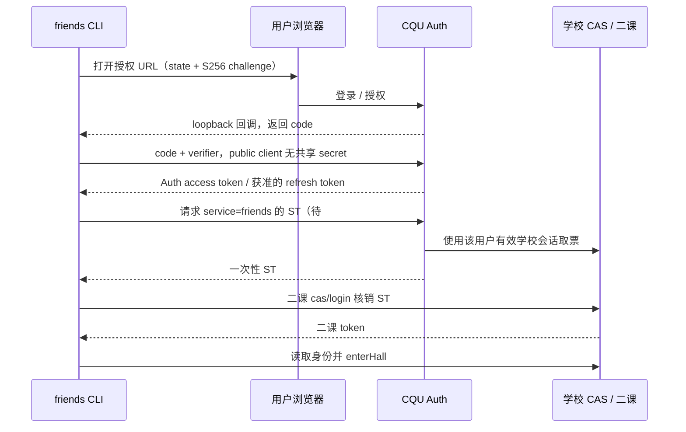

# CQU Auth 登录设计

日期：2026-10-22。状态：受控 SDK/CLI 实现记录；生产 native client 注册与真实 Auth→ST→学校 API 端到端验收仍未完成。Better Auth 仍是授权服务器；客户端 OAuth/DPoP 引擎按用户后续决定使用 `oauth4webapi@3.8.8`。

本文保留设计与调查过程；正式规格以 [Issue #1](https://github.com/cqu-moe/friends-cli/issues/1) 为准。规格要求 SDK 与 CLI 两层公开接口测试，Ego 录入流程由用户亲自最终提交。

## 后续进展

2026-10-22 用户后续决定：Better Auth 保持 CQU Auth 服务端/授权服务器角色；friends-cli 使用正式发布版 `oauth4webapi@3.8.8` 作为完整 native OAuth/DPoP 客户端引擎。该库提供 public client、S256、DPoP proof/nonce 管理和刷新请求；本仓库只实现回环回调、安全存储和 CLI 编排，不手写密码学。不能把该决定表述为 Better Auth 客户端自带 DPoP proof 签名，也不能沿用“客户端 DPoP 缺口仍阻塞”的旧状态。

2026-10-22：[Auth #95](https://github.com/cqu-moe/auth/pull/95) 已合并，PR 与合并提交 CI、Workers Builds 检查均通过。经正常浏览器读取线上 discovery，确认已包含 `cqu:ticket:friends`。下文早期调查中“尚未发布 friends scope”的结论已被此证据替代；未核实的其他客户端能力仍需接入时验证。

friends-cli #4 已在受控 HTTP 场景实现 SDK/CLI OAuth、DPoP、ST 与学校 API 链路。生产 native client 尚未注册，真实 Auth/学校端到端验收未完成；不能把 scope 发布或受控测试当作生产端到端完成。

## 用户看到的流程

```sh
friends auth login --method cqu-auth
```

1. CLI 在本机启动短时回调监听，打开 CQU Auth 的授权页。已登录 Auth 时可以复用网站登录态；是否显示同意页面取决于客户端授权策略。
2. 用户在浏览器完成登录和所需授权。CLI 接收授权码，用启动时保留的 PKCE verifier 换取 Auth access token，以及获准情况下的 refresh token。
3. CLI 用 `cqu:ticket:friends` 请求专属二课 ST。Auth 根据当前登录主体找到其学校绑定会话并出票，不接受 CLI 任意指定另一个用户。
4. CLI 将 ST 交给二课登录接口，取得二课自己的 token；再读取可用身份并进入选定角色/组织上下文。
5. 之后课程、活动和组织 API 使用二课会话。Auth 主要负责登录授权、刷新以及重新取得学校票据。

第 3 步依赖 [Auth #94](https://github.com/cqu-moe/auth/issues/94) 新增 friends 固定服务及权限；当前不以 `cqu:ticket:any` 作为默认替代。



## 三类凭据不能混用

| 凭据 | 用途 | 生命周期与保存 |
| --- | --- | --- |
| Auth access / refresh token | 调用获准的 Auth API / 刷新授权 | 系统凭据库存储，遵守到期、撤销与刷新轮换 |
| CAS Service Ticket（ST） | 登录指定的学校服务 | 短时、一次性，只在内存交接；不能核销两次 |
| 二课 token | 访问二课业务 API | 独立会话，失效后重新取 ST 建立 |

CLI 不接收学校 TGT 或共享 client secret。Auth 的账户 ID 不等于学号，二课角色与组织以二课实际返回值为准。

## 已核实与待接入的边界

依据当前 Auth 源码基线 `ce98d612880fd351285cedf4df0c2c9c244163d7` 与[线上发现元数据](https://auth.cqu.moe/api/auth/.well-known/openid-configuration)：

- issuer 保持 `https://auth.cqu.moe/api/auth`。授权与 token endpoint 位于 `/api/v1/auth/oauth2/authorize`、`/api/v1/auth/oauth2/token`，应从 discovery 读取并校验，不能把 issuer 改成 `/api/v1/auth`。
- 服务端客户端 schema 支持 native/public client、`token_endpoint_auth_method: none`、PKCE 和 `dpop_bound_access_tokens`。应通过现有注册/管理入口创建 CLI 客户端，不能分发 Web 客户端 secret。
- 线上 discovery 发布了 S256 和 DPoP 算法；尚未发布 `cqu:ticket:friends` 或 device authorization grant。不能假定设备码登录已经可用。
- discovery 当前 token auth methods 没有 `none`，与源码 public client 能力存在需要验证的差异。生产注册、实际 token endpoint 行为及 loopback 回调规则要一起确认，不能仅凭源码判断已可接入。
- 取票同时检查 access token scope 和客户端当前获准的 CQU scope；还要求学校绑定有效。固定服务模式与任意 serviceUrl 的 QuickLogin 策略不同。

计划注册 native public client，采用 loopback callback 与 S256 PKCE，申请所需 `cqu:ticket:friends`；需要刷新时申请 `offline_access`。仅在消费 OIDC 身份时添加相应 OIDC scopes。callback 绑定回环地址，校验路径、state 和授权响应 issuer；使用 ID token 时还须校验签名、issuer、audience、时效及适用的 nonce。

Auth 新权限落地后的取票请求：

```http
POST https://auth.cqu.moe/api/v1/cqu/service-tickets
Authorization: DPoP <access-token；不在日志输出>
Content-Type: application/json

{"service":"friends"}
```

预期沿用 HTTP 201、`{ "data": { "ticket": "<一次性 ST>" } }`。DPoP token 必须同时附带绑定该请求的有效 proof，不能只换 Authorization scheme。

二课部分依据接口库：CAS service 精确为 `https://friends.cqu.edu.cn/mobile/sso`，通过 `POST /gateway/ek-agg-mob/cas/login?ticket=...` 核销；然后调用 `checkUserAndGetUserLevel` 和 `enterHall` 建立身份上下文。不要先在浏览器访问并消耗同一张 ST，再拿它调用 API。

Ego 操作需要浏览器自身的二课登录态；API token 与浏览器状态不自动等价。后续须验证独立 ST 经网站 SSO 入口的完整跳转和身份一致性，不能直接把 API 已核销的票据再交给页面。

## 认证库决定与历史调查

下表保留当时的 Better Auth 公开导出调查，作为服务端兼容性证据；它不再是当前客户端实现方案。当前方案由上文“后续决定”确定：

| 部分 | 当前证据 / 设计 |
| --- | --- |
| Better Auth 服务端接口客户端 | `better-auth/client` 的 `createAuthClient` 提供登录、会话与插件调用；按实际需要使用，不为 CLI 新建认证服务或用户库 |
| PKCE 授权 URL | 官方 `better-auth/oauth2` 导出 `createAuthorizationURL`，传入 verifier 后生成 S256 challenge |
| 授权码换票 | 官方 `authorizationCodeRequest` / `validateAuthorizationCode`；public client 的具体参数以选定正式版本验证 |
| 刷新 token | 官方 `refreshAccessTokenRequest` / `refreshAccessToken`；轮换结果的持久化、并发互斥由本地会话层负责 |
| DPoP | 当前查到 `deriveDpopAth`、`deriveDpopJkt`、`verifyDpopProof`、`enforceDpopBinding` 等，主要用于派生和服务端验证；未找到完整公开客户端 proof 签名及 nonce 管理封装，不能声称 createAuthClient 已自动支持整条链路 |
| OAuth Provider 客户端插件 | `oauthProviderClient` 支持 provider 的前端交互；`oauthProviderResourceClient` 用于资源端验证，不等于独立 CLI 的完整 OAuth 登录管理器 |
| 本地应用集成 | 启动浏览器、回环监听、请求关联、凭据库和账号切换属于 CLI 集成工作，使用 Node 平台能力及成熟库 |

以上核对的是官方当前源码；实施时必须固定正式发布版本核对 exports、参数和行为。Auth 的 package.json 声明 Better Auth 1.7.7，而本地已安装 provider 目录曾显示 1.6.11，不能用旧 node_modules 推断正式契约。

DPoP 接入使用 `oauth4webapi` 的正式 API；若客户端策略要求 DPoP，绝不回退 Bearer。DPoP 私钥要与绑定的 refresh token 一起安全保存，不能每次启动重新生成。

官方依据：[Better Auth Client](https://www.better-auth.com/docs/concepts/client)、[OAuth 公共导出](https://github.com/better-auth/better-auth/blob/main/packages/core/src/oauth2/index.ts)、[授权 URL](https://github.com/better-auth/better-auth/blob/main/packages/core/src/oauth2/create-authorization-url.ts)、[授权码交换](https://github.com/better-auth/better-auth/blob/main/packages/core/src/oauth2/validate-authorization-code.ts)、[刷新](https://github.com/better-auth/better-auth/blob/main/packages/core/src/oauth2/refresh-access-token.ts)、[DPoP 实现](https://github.com/better-auth/better-auth/blob/main/packages/core/src/oauth2/dpop.ts)。

## 失效与恢复

- 二课会话到期：按原登录来源重新取票建立会话，再核对账号/上下文。不能自动重放上一次结果未知的业务写操作。
- Auth access token 到期：使用官方刷新流程；串行化并发刷新，安全保存轮换后的 token。刷新请求结果丢失时按服务端契约恢复，不能盲目循环重试旧 refresh token。
- Auth 刷新失败或授权撤销：返回需要重新登录。现有 Auth 刷新还依赖原始授权会话有效，不承诺无限离线续期。
- 学校绑定失效：提示到 Auth 恢复绑定；与 OAuth 登录失败、无 scope 和二课拒绝登录区分。
- DPoP 私钥缺失：不能重建另一把钥匙继续使用旧绑定 token，需重新授权；nonce 重试与业务写入重试分别处理。

受控验收已覆盖 public client/S256/state/回调目标、DPoP nonce/proof/同 key 刷新与资源调用、refresh 轮换和重放、密钥错误/缺失、多身份显式选择、ST 一次性核销、二课会话过期恢复、真实 CLI 子进程和 macOS Keyring。生产验收仍需完成 native/public client 注册、真实同意、线上 discovery/token endpoint 兼容、真实 ST 核销与学校 API 身份一致性；这些未完成前不能宣称生产端到端可用。
