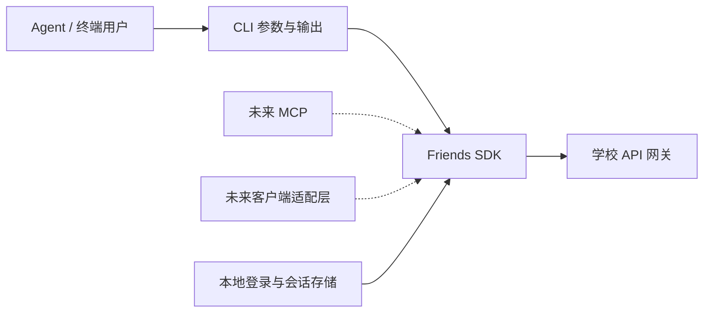

# friends-cli 初步设计

日期：2026-10-22。状态：讨论草案，尚未确认实现规格。命令、类型与目录均为提案，不代表已有实现。

## 已确认的目标

- 创建本地 CLI：课程浏览与搜索、志愿者和校内活动申请/审批/报名/认证、课程管理、团组织管理。
- 先封装可复用 SDK，CLI 调用 SDK，之后 MCP 和客户端也复用它。
- 公开仓库：https://github.com/cqu-moe/friends-cli 。规格与任务使用 GitHub Issues；采用默认五个 triage 标签。
- 技术栈采用 TypeScript + Node.js；首版单包分别提供 SDK 导出与 friends 命令（Q4 已确认）。
- 本轮先完成勘测和整体设计，不执行真实报名、审批、认证或组织成员变更。

## 当前证据

### 接口资料

读取 `cqu-api-endpoint-collection/USAGE.md`、`systems/friends/openapi.yaml` 和 `notes.md`。
2026-10-22 本地解析：523 条路径、545 个操作，143 标为 verified，402 标为 unverified，全部缺少 operationId。

注意：notes 说明一部分 verified 依据是生产前端引用及交叉核对，不能将 143 项全部解释为真实业务实测成功。
接口库当前有未提交修改，本草案依据其工作区文件，不以 HEAD 冒充该快照。

| 文件 | SHA-256 |
| --- | --- |
| systems/friends/openapi.yaml | 8424e264eb7d9f92c8d38e45bd0f2cd33db709a156b7791e7ce99b9ecf563b31 |
| systems/friends/notes.md | 24942fa01b653702445d66c6930b649a8adbcc8586b1446a51abf6f06603a76b |

### 本轮登录态页面勘测

入口：[第二课堂平台](https://friends.cqu.edu.cn/mobile/sso)。只读检查当前账号正常可访问的页面。

| 页面 | 观察到的行为 | 验证边界 |
| --- | --- | --- |
| 首页 | 课程管理、青年志愿者管理、组织活动管理、团组织管理、团员管理为不同入口 | 入口可见，不代表全部权限可用 |
| 课程查询 | 搜索框为“课程名称/主办方”，有“与我相关、所有课程、我的申请”视图 | 实际输入“周周艺”，等待加载后返回对应课程；未单独测试主办方匹配 |
| 课程管理 | 课程申请、补录课程申请、课程认证、课程查询、课程报名审批 | 已核对菜单，未提交表单 |
| 志愿者管理 | 校内活动管理、校内活动报名、校外活动管理、我的志愿成绩单 | 已核对菜单 |
| 校内志愿活动管理 | 活动申请、活动报名审批；列表分别显示申请状态和认证状态，并提供提交认证入口 | 已加载管理列表，未进行申请或认证 |
| 团组织管理 | 管理员组织查询、组织管理、成员组织查询、全校组织查询、加入/退出记录 | 已进入当前账号管理的组织 |
| 组织详情 | 简介与 Logo、第一负责人、成员查看、审核新成员、审核退出成员、下设部门、负责人变更申请 | 已核对详情入口，未读取成员名单、未修改资料 |

本轮没有直接重放学校 API，也未验证 CLI 环境的认证、网络可达性或写操作成功率。

## 领域边界

建议保留网站业务边界，避免将不同含义的 `apply` 合为一个操作：

| 概念 | 含义 | 与其他概念的区别 |
| --- | --- | --- |
| 开办申请 | 发起人申请举办课程或活动 | 与学生报名参加分开 |
| 报名 | 学生申请参加一项课程或活动 | 报名成功不等于认证成功 |
| 报名审批 | 管理者处理参加人员的报名申请 | 与审批活动开办分开 |
| 认证申请 | 提交活动结果、参与记录及所需材料，申请认定 | 志愿时长与课程成绩分开表达 |
| 认证审批 | 对认证申请作出决定 | 不与开办审批共用一个状态 |
| 组织管理 | 组织资料、成员、加入/退出审批、负责人变更申请 | 与团员入团、注册、评议分开 |

同一条记录可能同时包含活动阶段、开办审批状态、报名状态和认证状态。各字段独立保留；未知状态保留原值并标为未知，不能猜测为“已通过”。
这些定义先用于讨论；用户确认后的术语再进入 GLOSSARY.md。

## 架构提案

已确认使用 TypeScript + Node.js，先一个包提供 SDK 导出与 `friends` 可执行入口；无需提前搭大型 monorepo。



```text
src/
  sdk/
    client.ts                 # 会话、请求、业务错误与分页
    catalog.ts                # 跨类型摘要查询
    courses.ts                # 课程业务
    volunteers.ts             # 志愿者、志愿活动与时长认证
    activities.ts             # 组织活动
    organizations.ts          # 组织与成员
    schemas/                  # 已核实的业务输入约束
  cli/
    main.ts                   # 命令注册、参数解析与输出
    auth.ts                   # 选定登录方式与本地凭据存储
tests/
  fixtures/                   # 脱敏、可追溯的协议样例
docs/
  plans/
  adr/
  agents/
```

- SDK 不访问本地文件、终端、剪贴板或浏览器全局变量；接受会话和可替换的 HTTP 请求实现。
- CLI 负责文件读取、登录交互、输出格式和确认选项；不重复实现领域规则。
- 初期使用直接的业务方法，不建设通用工作流引擎、插件系统或完整学校接口生成器。
- SDK 的公开名称由业务决定。供应商路径、拼写错误、每服务 Header 和枚举差异只出现在 SDK 内部。
- SDK 的可复用性不等于纯浏览器 App 可以直接请求学校：CORS、凭据存储和原生网络适配仍需分别验证。

## 业务模块与契约缺口

下列路径相对于 `https://friends.cqu.edu.cn/gateway`，省略服务前缀处仅为便于阅读。

| SDK 模块 | 计划覆盖 | 现有接口依据 | 尚需核实 |
| --- | --- | --- | --- |
| catalog | 课程/组织活动/志愿活动摘要、关键词搜索、分页 | POST `/ek-agg-mob/activity/page-activity`，有 keyword/type/currentPage/pageSize | 主办方匹配语义、其他筛选与排序 |
| courses | 详情、报名、退出、开办申请、报名审批、课程认证与结果查询 | curriculum 的 apply、student-apply、attestation、student-transcript | 开办及认证写入字段、通用审批入口、补录与认证的关系 |
| volunteers | 身份状态、校内活动、报名审批、认证申请、时长查询 | young-volunteers 的 member、school-activity-apply、schoolActivityStudentApply、school-activity-attestation-apply | 写入 schema、岗位/人员/时长明细、附件要求、审批流程 |
| activities | 组织活动详情、报名、活动审批、报名审批 | team-organization-manage 的 apply-info、enroll-info | audit 请求体、权限与状态机 |
| organizations | 可管理组织、详情、成员、加入/退出审批、负责人变更申请 | team-organization-manage 的 student-organization-info/member/apply 等接口族 | 具体权限、部门操作、负责人变更申请字段 |

志愿服务中的“校内活动”和独立“组织活动”不能共用一套写入模型。可以统一搜索摘要，但详情与操作按 kind 分发。
团组织管理页面实际包含学生组织；不能仅凭菜单中文将其映射到 league-member-management。

## CLI 提案

以下命令表达目标形态，尚未实现。ID 示例均为虚构值。

```sh
friends auth login
friends auth status --json
friends context list --json
friends catalog search --kind course --query "志愿" --page 1 --page-size 20 --json
friends courses get course_demo --json
friends courses enroll course_demo --dry-run --json
friends volunteers activities list --scope managed --json
friends volunteers registrations list --activity activity_demo --json
friends volunteers registrations approve registration_demo --input approval.json --dry-run --json
friends volunteers certifications submit --input certification.json --dry-run --json
friends courses applications submit --input course.json --dry-run --json
friends organizations list --scope managed --json
friends organizations members list organization_demo --json
friends organizations membership-requests approve request_demo --dry-run --json
friends schema volunteers.certifications.submit --json
```

Agent-First 输出与调用约定：

- `--json` 在 stdout 输出一个稳定版本的 JSON 文档，诊断日志写 stderr；`--help`、schema、错误码可独立查询。
- 复杂输入支持 `--input 文件` 与 `--input -`；只接受已核实字段，不能把任意对象直接转发给学校。
- 正常调用直接完成单个明确操作；`--dry-run` 只做本地校验和必要只读检查，不能上传附件或保存远端草稿。
- 写操作展示对象、账号/角色/组织上下文及影响。非交互审批等操作要求显式确认选项，例如 `--yes`，不能等待隐藏提示。
- SDK 不弹确认框；相同输入校验与错误语义由所有入口共享，CLI/MCP/App 决定如何收集用户确认。
- 页面参数和返回值包含 items、page、pageSize、total（若服务提供）、hasMore；默认只请求一页。
- 不能假装支持学校未提供的服务端筛选。若增加本地筛选，必须显式报告扫描范围、是否完整及请求预算。
- 命令描述至少说明输入 schema、输出 shape、读写性质和实现状态，避免 Agent 调用只有名称没有可用契约的功能。

成功与失败结果建议保持以下形状，最终字段在实现规格中冻结：

```json
{"schemaVersion":1,"ok":true,"data":{"items":[]},"meta":{"page":1,"hasMore":false}}
```

```json
{"schemaVersion":1,"ok":false,"error":{"code":"AUTH_REQUIRED","message":"请先登录","retryable":false,"nextAction":"friends auth login"}}
```

退出码建议：0 成功，2 输入错误，3 认证失效，4 权限不足，5 业务拒绝/状态冲突，6 网络或上游协议错误，7 写入结果不确定。

## SDK 接入原则

- 成功要求识别学校业务响应，而不只判断 HTTP 200。兼容学校业务错误包和网关非业务错误包，保留脱敏 requestId 便于定位。
- 角色发现与 enterHall 属于会话建立步骤；根据服务器返回的可用身份选择上下文，不用 `--admin` 之类选项伪造权限。
- 每个 SDK client 固定账号与角色/组织上下文，切换时重建或串行处理；避免并发调用共享可变的身份 Header。
- 每服务 H-Zove-AppKey、H-Zove-UserLevel 等 Header 在内部构造。课程、报名记录、认证申请、组织的 ID 参数分别命名；不能把所有 uuid 视为同一种 ID。
- `COURSE` 与 `CURRICULUM` 只在已确认的具体接口边界映射，不建设一个猜测性的全局枚举转换器。
- 重试按业务操作定义：查询 POST 可能可重试，签到 GET 也可能改变数据。禁止用 HTTP 方法直接决定读写性质。
- 写请求超时返回 `UNKNOWN_OUTCOME`，不得自动重试。存在明确查询接口时回查；无法回查则保留未确认状态，不宣称成功或失败。
- 本地去重无法保证上游幂等；没有学校协议证据时，不承诺 exactly-once。
- 认证材料可能涉及附件和多步提交。附件上传、草稿保存和最终提交分别处理；没有确认的回滚接口时不自动删除远端记录。
- 未核实的写入 schema 不进入稳定 SDK/CLI。先补证据，再实现对应业务操作，避免把 `additionalProperties: true` 当成可用契约。

## 登录与存储：待决策

SDK 只接收会话；CLI 具体采用哪条登录路径需要用户选择并做原型验证。

1. 本地学校登录：浏览器完成 CQU 登录，再建立二课会话。目标是单机独立使用；首次会话交接方式、可用浏览器与过期恢复仍需验证。
2. 接入 CQU Auth：当前本地 auth 仓库包含公开客户端和服务取票相关设计，但文档存在版本差异；必须以当前源码/契约确认 CLI 回调方式、scope、授权门槛与 friends 取票链路，不能直接复制旧示例。

凭据放在仓库外，优先系统凭据库；不得进入命令行参数、日志、fixtures 或 Git。若采用文件存储，必须明确文件权限和平台支持边界。首版建议一个登录账号，支持该账号已有的身份/组织上下文。

## 分步交付与验收

每一步都交付一条可用业务链，全部阶段完成才覆盖用户提出的范围。

1. 登录与查询：会话建立 → 能力/上下文确认 → 课程搜索 → 详情；固定 JSON、错误和分页契约。
2. 志愿管理：管理活动查询 → 报名审批 → 认证材料校验/提交 → 状态回查；并覆盖学生报名、退出、时长查询。
3. 课程与组织活动：开办申请、报名与审批、课程认证，分别核实各自流程；未确认入口先列为缺口。
4. 组织管理：资料与成员查询、加入/退出审批、负责人变更申请；部门修改和权限调整的范围待确认。
5. 后续接入 MCP 与客户端，复用 SDK，不在第一版搭空壳服务。

验收层次分别记录：输入/状态转换单测、脱敏响应契约测试、CLI 子进程 JSON 与退出码测试、真实登录态只读测试、经授权样例的写入及结果回查。Mock 通过不等于真实写操作可用。
重点回归：非零业务码、登录失效、分页边界、未知状态、错误 ID、无权限、写入超时与重复执行。

## 当前设计问题

- 登录优先独立本地学校登录，还是接入现有 CQU Auth？
- 团组织第一版是否覆盖组织资料、成员查询、加入/退出审批、负责人变更申请；下设部门编辑与团员管理是否另列范围？

共享理解确认后再固化规格、拆 GitHub Issues；本草案不自动视为已批准实施。
