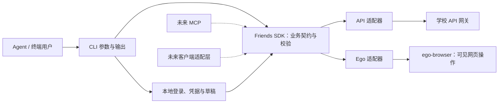

# friends-cli 初步设计

日期：2026-10-22。状态：整体设计草案；技术栈、双登录、API/Ego 双操作方式、Ego 录入后人工审核及提交、Better Auth 选型与团组织首版范围已确认，详细接口契约仍待验证。命令、类型与目录均为提案，不代表已有实现。

## 已确认的目标

- 创建本地 CLI：课程浏览与搜索、志愿者和校内活动申请/审批/报名/认证、课程管理、团组织管理。
- 先封装可复用 SDK，CLI 调用 SDK，之后 MCP 和客户端也复用它。
- 公开仓库：https://github.com/cqu-moe/friends-cli 。规格与任务使用 GitHub Issues；采用默认五个 triage 标签。
- 技术栈采用 TypeScript + Node.js；首版单包分别提供 SDK 导出与 friends 命令（Q4 已确认）。
- 首版同时支持独立本地学校登录和 CQU Auth 登录（Q5 已确认）。
- 所有范围内业务均以 API 直接调用和 Ego 有头浏览器显式操作为目标，共享业务数据与本地草稿；两条路径的自动化终点按操作明确声明。志愿者录入等需人工审阅的 Ego 流程止于填表与交接，由用户审核并亲自最终提交。
- 认证统一采用 Better Auth 的客户端及官方 OAuth 工具；优先使用现成库，不另起 OAuth 实现。DPoP 客户端能力缺口单独验证，不因选型而降低安全要求。
- 团组织首版覆盖组织资料、成员查询、加入/退出审批、负责人变更申请；下设部门编辑与团员入团/注册/评议留待后续（Q6 已确认）。
- 本轮先完成勘测和整体设计，不执行真实报名、审批、认证或组织成员变更。

## 当前证据

### 接口资料

读取 `cqu-api-endpoint-collection/USAGE.md`、`systems/friends/openapi.yaml` 和 `notes.md`。
2026-10-22 本地解析：523 条路径、545 个操作，143 标为 verified，402 标为 unverified，全部缺少 operationId。

注意：notes 说明一部分 verified 依据是生产前端引用及交叉核对，不能将 143 项全部解释为真实业务实测成功。
接口库当前有未提交修改，本草案依据其工作区文件，不以 HEAD 冒充该快照。

| 文件 | SHA-256 |
| --- | --- |
| systems/friends/openapi.yaml | 8424e264eb7d9f92c8d38e45bd0f2cd33db709a156b7791e7ce99b9ecf563b31 |
| systems/friends/notes.md | 24942fa01b653702445d66c6930b649a8adbcc8586b1446a51abf6f06603a76b |

### 本轮登录态页面勘测

入口：[第二课堂平台](https://friends.cqu.edu.cn/mobile/sso)。只读检查当前账号正常可访问的页面。

| 页面 | 观察到的行为 | 验证边界 |
| --- | --- | --- |
| 首页 | 课程管理、青年志愿者管理、组织活动管理、团组织管理、团员管理为不同入口 | 入口可见，不代表全部权限可用 |
| 课程查询 | 搜索框为“课程名称/主办方”，有“与我相关、所有课程、我的申请”视图 | 实际输入“周周艺”，等待加载后返回对应课程；未单独测试主办方匹配 |
| 课程管理 | 课程申请、补录课程申请、课程认证、课程查询、课程报名审批 | 已核对菜单，未提交表单 |
| 志愿者管理 | 校内活动管理、校内活动报名、校外活动管理、我的志愿成绩单 | 已核对菜单 |
| 校内志愿活动管理 | 活动申请、活动报名审批；列表分别显示申请状态和认证状态，并提供提交认证入口 | 已加载管理列表，未进行申请或认证 |
| 团组织管理 | 管理员组织查询、组织管理、成员组织查询、全校组织查询、加入/退出记录 | 已进入当前账号管理的组织 |
| 组织详情 | 简介与 Logo、第一负责人、成员查看、审核新成员、审核退出成员、下设部门、负责人变更申请 | 已核对详情入口，未读取成员名单、未修改资料 |

追加勘测：当前账号可打开志愿活动认证页 `/mobile/volunteerManage/campusActivityCerApply`，页面按钮为“全部认证、添加名单、设置时长、提交认证”，未发现独立保存入口。生产脚本 `Index.cacfcbbe.js` 的 `attestApply` 分支仅跳转至该表单；未点击最终提交，也未添加真实人员。现有接口资料未记录独立的认证人员草稿保存接口，这不证明后端绝无该能力。

本轮没有直接重放学校 API，也未验证 CLI 环境的认证、网络可达性或写操作成功率。

## 领域边界

建议保留网站业务边界，避免将不同含义的 `apply` 合为一个操作：

| 概念 | 含义 | 与其他概念的区别 |
| --- | --- | --- |
| 开办申请 | 发起人申请举办课程或活动 | 与学生报名参加分开 |
| 报名 | 学生申请参加一项课程或活动 | 报名成功不等于认证成功 |
| 报名审批 | 管理者处理参加人员的报名申请 | 与审批活动开办分开 |
| 认证申请 | 提交活动结果、参与记录及所需材料，申请认定 | 志愿时长与课程成绩分开表达 |
| 认证审批 | 对认证申请作出决定 | 不与开办审批共用一个状态 |
| 组织管理 | 组织资料、成员、加入/退出审批、负责人变更申请 | 与团员入团、注册、评议分开 |

同一条记录可能同时包含活动阶段、开办审批状态、报名状态和认证状态。各字段独立保留；未知状态保留原值并标为未知，不能猜测为“已通过”。
基础领域术语见根目录 [GLOSSARY.md](../../GLOSSARY.md)。具体审批状态与上游枚举的对应关系仍须逐项核实。

## 架构提案

已确认使用 TypeScript + Node.js，先一个包提供 SDK 导出与 `friends` 可执行入口；无需提前搭大型 monorepo。



```text
src/
  sdk/
    client.ts                 # 注入操作实现与账号/角色上下文
    courses.ts                # 课程业务
    volunteers.ts             # 志愿活动与时长认证
    activities.ts             # 组织活动
    organizations.ts          # 组织与成员
    catalog.ts                # 跨类型摘要查询
    schemas/                  # 两种操作方式共享的输入和结果契约
  adapters/
    api.ts                    # 学校网关、Header、业务错误与分页
    ego.ts                    # 调用已安装 ego-browser，按可见页面执行
  local/
    auth.ts                   # Better Auth 接入、本地学校登录、凭据存储
    drafts.ts                 # 本地草稿读取、校验与原子保存
  cli/
    main.ts                   # 命令注册、参数解析与输出
tests/
  fixtures/                   # 脱敏、可追溯的协议样例
docs/
  plans/
  adr/
  agents/
```

- SDK 核心不访问本地文件、终端、剪贴板或浏览器全局变量；两种适配器复用领域数据、输入校验和通用错误模型，各自声明可执行的操作阶段。Ego 录入使用 prepare，API 正式提交使用 submit；不能强行用同一个 submit 接口掩盖人工边界。
- API 客户端仍可单独使用；Ego 与本地存储从可选的 Node 导出加载。普通 SDK 导入不启动浏览器，不要求安装 Ego。
- CLI 负责文件读取、登录交互、输出格式和确认选项；不重复实现领域规则。
- 初期只用两个具体适配器，不建设通用工作流引擎、插件注册系统或完整学校接口生成器。
- SDK 的公开名称由业务决定。供应商路径、拼写错误、每服务 Header 和枚举差异只出现在 API 适配器内部；页面定位规则只出现在 Ego 适配器内部。
- SDK 的可复用性不等于纯浏览器 App 可以直接请求学校：CORS、凭据存储和原生网络适配仍需分别验证。

### API 与 Ego 的操作约定

登录来源由 `auth login --method local|cqu-auth` 选择，业务执行方式由 `--via api|ego` 选择，二者独立。查询提案默认 API，显式指定 Ego 时在可见页面中操作；录入与提交必须使用不同动作，不能只换 via 就改变其副作用。

- 两条路径共享人员、活动、组织等领域数据和草稿格式；相同查询保持相同语义。写入流程按 prepare、submit、status 区分阶段，分别声明 supportedVia 和结果含义，不能用填表成功替代提交成功。
- Ego 通过已安装的 `ego-browser` 完成正常导航、点击、填写和文件选择；不重新封装浏览器引擎，也不以页面中的隐藏 fetch 冒充显式操作。
- 同一协作流程复用一个 task space，提供可恢复的会话引用。人接管后停止 Agent 操作；明确交还后重新检查页面、账号、组织和活动，再继续。
- API 会话与浏览器会话分别管理，每次写入前核对目标账号及组织。CQU Auth 到 Ego 的会话交接须实测；不默认复制 token 就能登录，不复用已核销 ST。
- 目标业务两边都覆盖；Ego 的人工审阅和最终点击是该路径的一部分，不要求 Agent 自动完成提交。若网页没有入口或 API 契约未确定，报告具体缺口，不能默默切换路径；不能在 Ego 录入后转为 API 提交。
- 区分 `prepared`（已填表）、`awaiting-user`（等待人工审核与亲自提交）、`submitted`（已提交）和 `verified`（结果已回查）。Ego prepare 只能返回前两种状态及 submitted=false；用户提交后，经允许的只读回查才能记录后两种状态。
- 未来 MCP/App 复用业务层；Ego 能力要求本机有浏览器运行环境，不能宣称普通远端 MCP 主机可直接使用用户本机页面。

### Ego 表单录入的人工边界

用户明确要求：志愿者录入等表单流程只填入页面，由人审阅并亲自提交。这里的“人工审核”指提交前检查，不是学校后续指导教师/单位的认证审批。

- `certifications.prepare --via ego` 根据草稿使用可见表单操作录入人员与时长，展示录入结果、差异和未处理项，然后 handOff 并保留页面。完成条件是页面已准备好等待人处理。
- 不点击“提交认证”，不触发表单 submit/快捷键提交，不调用 SDK 提交方法，也不通过页面 fetch/evaluate、隐藏按钮或其他通道最终提交。正常页面操作触发的人员查询等请求不等于正式提交；须先验证“添加名单/设置时长”等控件的真实副作用。
- `certifications.submit` 仅支持显式 `--via api`；`submit --via ego` 在执行前返回不支持该操作的输入错误（退出码 2），引导使用 prepare。`--yes`、dry-run 或人工说“已审核”都不将 Ego prepare 变为 Agent 代提交。
- prepare 不自动链到 API submit。独立 API 提交能力保留，但必须是另行明确选择的 API 操作；不能用于完成这次要求人工提交的 Ego 任务。
- 交接后停止 Agent 控制；用户可以继续编辑、取消或亲自点击提交。用户明确交还后重新读页面，必要时捕获新版草稿；用户要求核对提交结果时，只读查询状态，不补点提交。
- 回填失败、网页自动最终提交或控件副作用不明时停止并报告，不能为了“完成”改走 API。页面和本地草稿保留已知状态；提交结果未知时不得重放。

### 志愿认证的本地草稿

目标是让“人员和时长已经整理好，但尚未提交认证”可以保存、关闭并恢复；草稿是本项目的本地能力，不冒充学校已经保存的记录。

1. 从已授权的活动与报名数据建立草稿，或从 Ego 当前表单捕获已编辑内容。保存活动/组织/账号绑定、人员标识、岗位、时长与材料引用；业务字段仍以实测契约为准。
2. 草稿允许尚未填完，保存前检查结构；最终提交另做完整校验。每次 CLI 修改原子保存，冲突时保留双方内容，不覆盖更新版本。
3. 同一草稿可经明确选择用于独立 API 提交，或通过 Ego prepare 打开目标活动、逐项添加指定人员并设置指定时长。Ego 只录入和交接，人工检查后由用户亲自点击“提交认证”。回填前预览差异，不覆盖用户新编辑，也不把未知人员自动加入另一活动。
4. 人在 Ego 修改后可再次捕获并保存；在离开/交接前提供保存检查点。不能承诺关闭浏览器时未捕获的手动修改自动落盘。
5. 本地保存不上传附件、不调用学校提交接口。附件记录本地引用和校验信息，恢复时验证文件仍可用；网页已上传附件无法导出时明确列为缺失，不能宣称完整恢复。
6. API submit 需要独立、明确的提交意图；Ego 只等待用户亲自提交，用户交还后只读回查可用申请 ID 和结果。网络中断保留草稿与 `UNKNOWN_OUTCOME`，先查服务器再决定是否重试。未观察到最终提交时保持 awaiting-user，不能自行提交或宣称成功。

草稿带 schemaVersion 和 revision，保存在仓库外的用户数据目录。它可能含人员信息，默认限制本机访问权限；输出、示例、Git 和 Issue 不包含真实名单。当前阶段无需数据库、同步服务或专门的草稿 Web UI。

## 业务模块与契约缺口

下列路径相对于 `https://friends.cqu.edu.cn/gateway`，省略服务前缀处仅为便于阅读。

| SDK 模块 | 计划覆盖 | 现有接口依据 | 尚需核实 |
| --- | --- | --- | --- |
| catalog | 课程/组织活动/志愿活动摘要、关键词搜索、分页 | POST `/ek-agg-mob/activity/page-activity`，有 keyword/type/currentPage/pageSize | 主办方匹配语义、其他筛选与排序 |
| courses | 详情、报名、退出、开办申请、报名审批、课程认证与结果查询 | curriculum 的 apply、student-apply、attestation、student-transcript | 开办及认证写入字段、通用审批入口、补录与认证的关系 |
| volunteers | 身份状态、校内活动、报名审批、认证申请、时长查询 | young-volunteers 的 member、school-activity-apply、schoolActivityStudentApply、school-activity-attestation-apply | 写入 schema、岗位/人员/时长明细、附件要求、审批流程 |
| activities | 组织活动详情、报名、活动审批、报名审批 | team-organization-manage 的 apply-info、enroll-info | audit 请求体、权限与状态机 |
| organizations | 可管理组织、详情、成员、加入/退出审批、负责人变更申请 | team-organization-manage 的 student-organization-info/member/apply 等接口族 | 具体权限、部门操作、负责人变更申请字段 |

志愿服务中的“校内活动”和独立“组织活动”不能共用一套写入模型。可以统一搜索摘要，但详情与操作按 kind 分发。
团组织管理页面实际包含学生组织；不能仅凭菜单中文将其映射到 league-member-management。

## CLI 提案

以下命令表达目标形态，尚未实现。ID 示例均为虚构值。

```sh
friends auth login --method local
friends auth login --method cqu-auth
friends auth status --json
friends context list --json
friends catalog search --kind course --query "志愿" --page 1 --page-size 20 --json
friends courses get course_demo --json
friends courses enroll course_demo --dry-run --json
friends volunteers activities list --scope managed --json
friends volunteers registrations list --activity activity_demo --json
friends volunteers registrations approve registration_demo --input approval.json --dry-run --json
friends volunteers certifications draft create --activity activity_demo --via api --json
friends volunteers certifications draft capture --via ego --session session_demo --json
friends volunteers certifications prepare --draft draft_demo --via ego --json
friends volunteers certifications submit --draft draft_demo --via api --dry-run --json
friends volunteers certifications status --activity activity_demo --via ego --json
friends volunteers certifications submit --input certification.json --via api --dry-run --json
friends courses applications submit --input course.json --dry-run --json
friends organizations list --scope managed --json
friends organizations members list organization_demo --json
friends organizations membership-requests approve request_demo --dry-run --json
friends schema volunteers.certifications.prepare --json
friends schema volunteers.certifications.submit --json
```

上例 Ego prepare 只录入并交接；status 是用户交还页面后可用的只读查询。prepare 的结果示例：

```json
{"schemaVersion":1,"ok":true,"data":{"operation":"volunteers.certifications.prepare","status":"awaiting-user","submitted":false,"draftId":"draft_demo","session":"session_demo","nextAction":"请在 Ego 中核对名单与时长，并亲自点击提交认证"},"meta":{"via":"ego"}}
```

这里 ok=true 仅表示准备和交接成功，不表示认证已提交。prepare --dry-run 只校验，不录入、不提交。

Agent-First 输出与调用约定：

- `--json` 在 stdout 输出一个稳定版本的 JSON 文档，诊断日志写 stderr；`--help`、schema、错误码可独立查询。
- 复杂输入支持 `--input 文件` 与 `--input -`；只接受已核实字段，不能把任意对象直接转发给学校。
- 正常调用直接完成单个明确操作；`--dry-run` 只做本地校验和必要只读检查，不能上传附件或保存远端草稿。
- 写操作展示对象、账号/角色/组织上下文及影响。允许自动执行的非交互审批等操作要求显式确认选项，例如 `--yes`；该选项不能绕过 Ego 表单必须人工提交的边界。
- SDK 不弹确认框；输入校验、支持的操作阶段和禁止自动提交的规则由所有入口共享。CLI/MCP/App 可以选择呈现方式，不能把 awaiting-user 自动转换成 submit。
- 页面参数和返回值包含 items、page、pageSize、total（若服务提供）、hasMore；默认只请求一页。
- 不能假装支持学校未提供的服务端筛选。若增加本地筛选，必须显式报告扫描范围、是否完整及请求预算。
- 命令描述至少说明输入 schema、输出 shape、读写性质、两条路径的可用性和验证状态，避免 Agent 调用只有名称没有可用契约的功能。
- `--dry-run --via ego` 可以读取页面与校验，但不能填写可能触发自动保存的表单；回填草稿是独立的准备操作。JSON meta 报告实际 via、目标上下文和验证依据。

成功与失败结果建议保持以下形状，最终字段在实现规格中冻结：

```json
{"schemaVersion":1,"ok":true,"data":{"items":[]},"meta":{"page":1,"hasMore":false}}
```

```json
{"schemaVersion":1,"ok":false,"error":{"code":"AUTH_REQUIRED","message":"请先登录","retryable":false,"nextAction":"friends auth login"}}
```

退出码建议：0 成功，2 输入错误，3 认证失效，4 权限不足，5 业务拒绝/状态冲突，6 网络或上游协议错误，7 写入结果不确定。

## 上游接入原则

- 成功要求识别学校业务响应，而不只判断 HTTP 200。兼容学校业务错误包和网关非业务错误包，保留脱敏 requestId 便于定位。
- 角色发现与 enterHall 属于会话建立步骤；根据服务器返回的可用身份选择上下文，不用 `--admin` 之类选项伪造权限。
- 每个 SDK client 固定账号与角色/组织上下文，切换时重建或串行处理；避免并发调用共享可变的身份 Header。
- 每服务 H-Zove-AppKey、H-Zove-UserLevel 等 Header 在内部构造。课程、报名记录、认证申请、组织的 ID 参数分别命名；不能把所有 uuid 视为同一种 ID。
- `COURSE` 与 `CURRICULUM` 只在已确认的具体接口边界映射，不建设一个猜测性的全局枚举转换器。
- 重试按业务操作定义：查询 POST 可能可重试，签到 GET 也可能改变数据。禁止用 HTTP 方法直接决定读写性质。
- 写请求超时返回 `UNKNOWN_OUTCOME`，不得自动重试。存在明确查询接口时回查；无法回查则保留未确认状态，不宣称成功或失败。
- 本地去重无法保证上游幂等；没有学校协议证据时，不承诺 exactly-once。
- 认证材料可能涉及附件和多步提交。附件上传、草稿保存和最终提交分别处理；没有确认的回滚接口时不自动删除远端记录。
- 未核实的写入 schema 不进入稳定 SDK/CLI。先补证据，再实现对应业务操作，避免把 `additionalProperties: true` 当成可用契约。

## 登录与存储：双方式已确认

首版同时支持两条登录路径，由 `friends auth login --method local|cqu-auth` 显式选择。两者最终建立同一种二课会话，SDK 的课程、活动和组织操作不感知登录来源。

1. 本地学校登录：浏览器完成 CQU 登录，再建立二课会话。目标是单机独立使用；首次会话交接方式、可用浏览器与过期恢复仍需验证。
2. CQU Auth 登录：以 native public client 通过授权码 + S256 PKCE 登录，再申请 `cqu:ticket:friends` 对应 ST，换取二课会话。新增固定服务与权限已由 [Auth #94](https://github.com/cqu-moe/auth/issues/94) 跟踪，当前尚不可当作已部署能力。详细流程、凭据区分与恢复策略见 [CQU Auth 登录设计](2026-10-22-cqu-auth-login.md)。

认证选型已确定为 Better Auth：使用 `better-auth/client` 中适用的客户端接口与 `better-auth/oauth2` 官方工具，不因服务端已有 Better Auth 就假定 `createAuthClient` 自动完成原生 CLI 的整条 OAuth 链。当前官方源码提供 PKCE、授权码换票与刷新工具；DPoP 已查到服务端校验，客户端 proof 签名、nonce 处理及持久化须按正式发布版本验证。没有经验证的客户端支持时保持缺口状态，不手写密码学或静默降级。

实现上仅需两个登录入口和共用的二课会话初始化，不提前建设认证插件框架。本地方式不依赖 CQU Auth 可用性；CQU Auth 方式不向 CLI 分发共享 client secret 或学校 TGT。

- 新登录成功后从学校服务重新读取账号、角色和上下文，不能沿用上一次登录的组织或权限。
- 会话记录其登录来源；失效后按原方式恢复或返回需要重新登录，不静默切换方式或账号。
- `auth status --json` 仅返回登录方式、会话状态和必要账号/上下文摘要，不返回 token、ticket、cookie 或刷新凭据。
- 学校会话过期、CQU Auth 授权失效、取票失败和学校拒绝登录分别报告，不能全部解释为“密码错误”。

凭据放在仓库外，优先系统凭据库；不得进入命令行参数、日志、fixtures 或 Git。若采用文件存储，必须明确文件权限和平台支持边界。首版建议一个登录账号，支持该账号已有的身份/组织上下文。

## 分步交付与验收

每一步都交付一条可用业务链，全部阶段完成才覆盖用户提出的范围。

1. 登录与查询：本地与 CQU Auth 两条路径分别建立会话 → 共用能力/上下文确认 → 课程搜索 → 详情；固定 JSON、错误和分页契约，并分别验证 API 和 Ego。补齐 Better Auth CLI 互操作与 DPoP 客户端缺口，才算完成相应登录能力。
2. 志愿管理优先交付认证草稿：活动查询 → 添加人员/时长 → 本地保存 → 关闭恢复 → API 独立提交，或 Ego 录入后交接人工审核及亲自提交 → 状态回查；并覆盖开办申请/审批、报名审批、学生报名、退出、时长查询。
3. 课程与组织活动：开办申请、报名与审批、课程认证，分别核实各自流程；未确认入口先列为缺口。
4. 组织管理：组织资料维护、成员查询、加入/退出审批、负责人变更申请。首版不包含下设部门编辑、任意权限调整，以及另一模块的团员入团/注册/评议。
5. 后续接入 MCP 与客户端，复用 SDK，不在第一版搭空壳服务。

所有范围内业务建立 API/Ego 覆盖矩阵：共享数据、可执行阶段、最终提交执行者、权限、页面入口/API 实测、回查和缺口。志愿认证明确标为 API submit / Ego prepare + human submit；人工提交是既定设计，不是等待补齐的自动化缺口。

验收层次分别记录：输入/状态转换单测、脱敏响应契约测试、CLI 子进程 JSON 与退出码测试、真实登录态只读测试、Ego 可见操作与人工接管/恢复、草稿关闭重开及跨路径恢复、经授权样例的写入及结果回查。Mock 通过不等于真实写操作可用。
重点回归：非零业务码、登录失效、分页边界、未知状态、错误 ID、无权限、写入超时与重复执行。Ego 另验收 prepare 过程中未发生最终提交请求、未点击提交、页面保持可人工编辑、--yes 不能绕过、拒绝 submit --via ego 且不回退 API；用户修改后捕获保存不提交，用户亲自提交后仅做只读回查。

## 待技术验证的事实

- 本地浏览器登录完成后，如何可靠地交接二课会话，以及过期后的恢复方式。
- Better Auth 正式发布版本的原生 public client / PKCE / DPoP 端到端互操作；线上 discovery 未列出 token auth method `none` 与源码支持 public client 的差异。
- Auth #94 部署后，生产 CLI 客户端注册、精确回调与 friends 取票核销链路。
- Ego 页面捕获/回填完整性，以及各表单是否存在自动保存副作用。
- CLI 直接请求学校 API 的网络行为，以及两个登录来源下的身份和权限一致性。
- 各申请、审批、认证和组织资料写操作的字段、附件要求、流程状态及回查方法。

以上是需要调查或原型验证的技术问题，不是让用户补充接口事实。后续实现前应据此固化规格和拆分实现任务；设计草案在 GitHub Issue 跟踪，本轮仍只交付整体设计。
